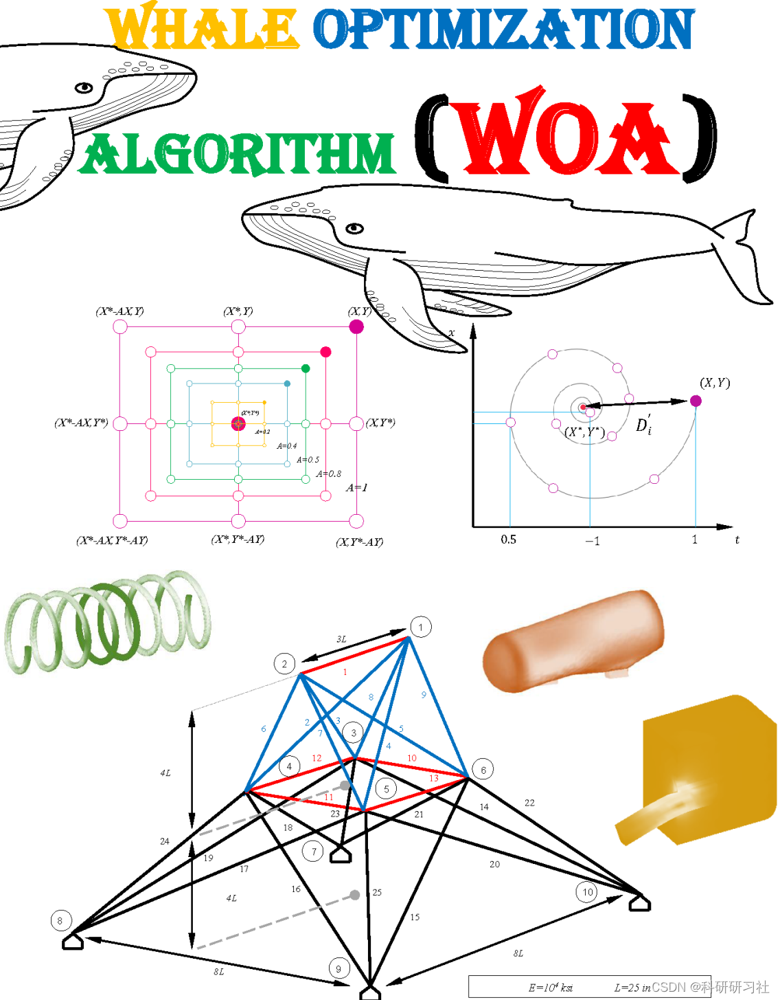
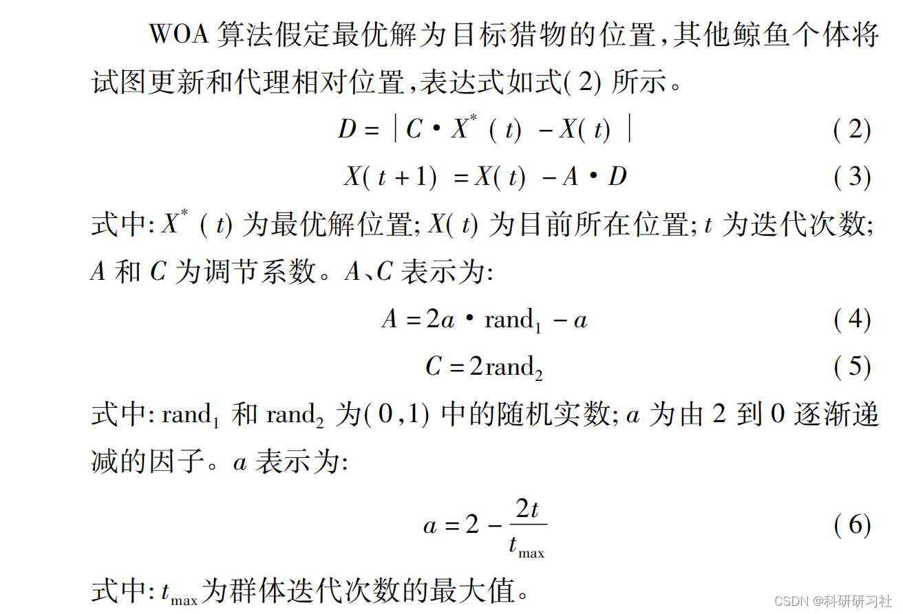
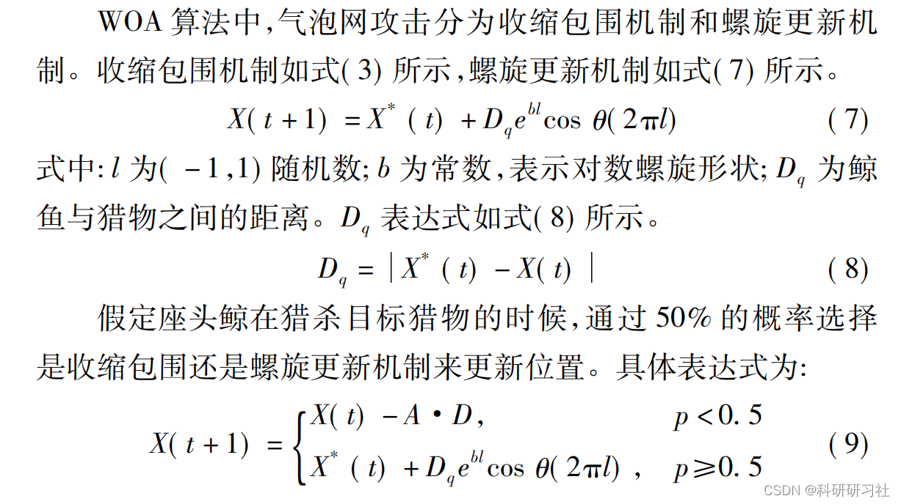
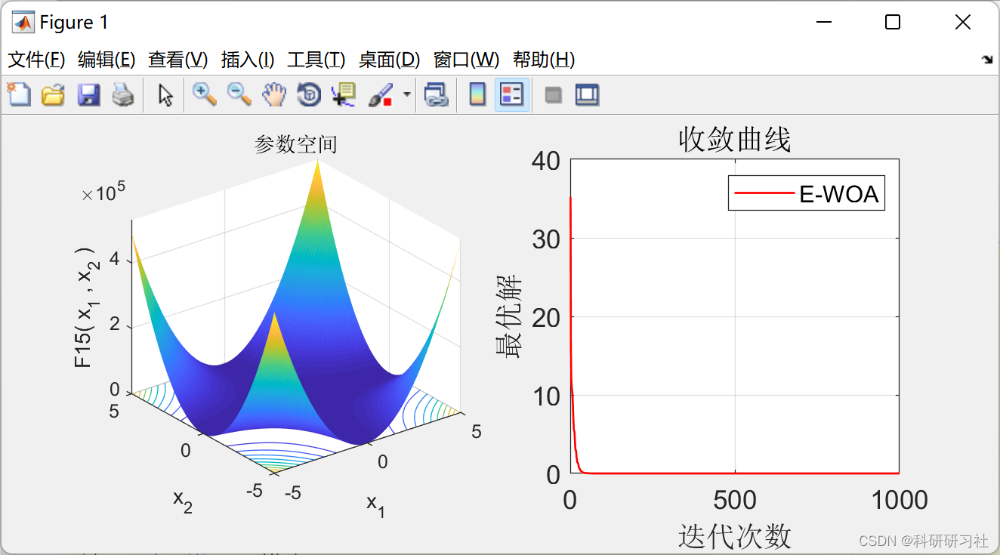
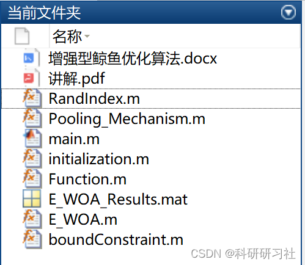

# Intelligent Optimization Algorithms | Enhanced Whale Optimization Algorithm (E-WOA) (Matlab Code Implementation)

1. Overview of the WOA in 2016 proposed by Mirjalili et al. [6. This is a novel, powerful group intelligent optimization algorithm with strong search capabilities and positive feedback characteristics, capable of achieving global optimization. The algorithm includes three behaviors: encircling prey, bubble net attack, and searching for prey.

2.1 Encircling Prey
2.2 Bubble Net Attack
2.3 Searching for Prey
3. Flowchart
4. Enhanced Whale Optimization Algorithm (E-WOA)
This paper introduces an enhanced version of the Whale Optimization Algorithm (E-WOA), which employs pooling mechanisms and three effective search strategies: migration, priority selection, and enriched encircling prey. Evaluating the performance of E-WOA and comparing it with well-known variants of WOA to address global optimization problems. The results obtained indicate that E-WOA outperforms its variant counterparts. Once E-WOA demonstrated sufficient performance, it was used to propose a binary E-WOA named BE-WOA to select effective features, particularly from medical data sets. BE-WOA was validated using a medical disease dataset and compared with state-of-the-art high-performance optimization algorithms in terms of adaptability, accuracy, sensitivity, precision, and feature count. Details are available in Section 6.
5. Running Results
6. Matlab Code and Detailed Article
This article only showcases part of the code; the complete code can be found in:

## Images

<!-- PAYMENT_BLOCK -->

## Get this dataset

- Payment link (Stripe): [Buy now](https://buy.stripe.com/3cs8yP7sY87d0vu9AB)
- Payment QR code: 

<!-- /PAYMENT_BLOCK -->
